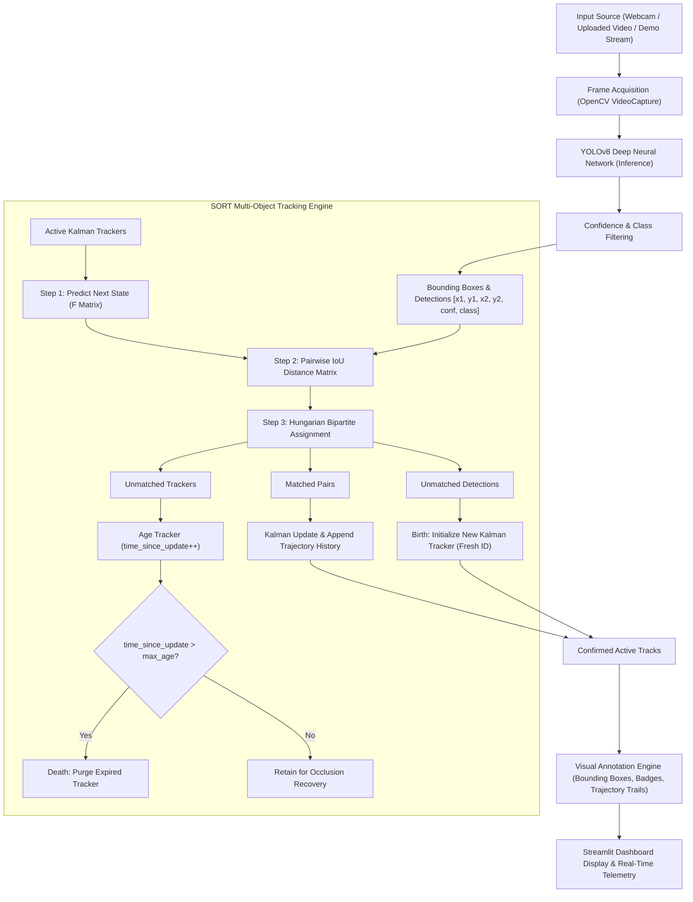

# 🎯 Object Detection and Tracking using YOLOv8, OpenCV, and SORT

[](https://www.python.org/)
[](https://github.com/ultralytics/ultralytics)
[-orange.svg)](https://arxiv.org/abs/1602.00763)
[](https://streamlit.io/)
[](tests/test_detection.py)
[](https://codealpha.tech/)

A production-grade, real-time Computer Vision system capable of identifying multiple objects across video frames and maintaining persistent identities via the **SORT (Simple Online and Realtime Tracking)** algorithm. Powered by **YOLOv8**, **OpenCV**, **Kalman Filtering**, **Hungarian Bipartite Assignment**, and an interactive **Streamlit** dashboard.

Developed for the **CodeAlpha Artificial Intelligence Internship (Project 2)**.

---

## 📑 Table of Contents

- [Core Concepts & Foundations](#-core-concepts--foundations)
  - [What is Computer Vision?](#1-what-is-computer-vision)
  - [What is Object Detection?](#2-what-is-object-detection)
  - [What is YOLO (You Only Look Once)?](#3-what-is-yolo-you-only-look-once)
  - [What are Bounding Boxes?](#4-what-are-bounding-boxes)
  - [What is Object Tracking?](#5-what-is-object-tracking)
  - [What is SORT?](#6-what-is-sort)
  - [What is Kalman Filtering?](#7-what-is-kalman-filtering)
  - [What is Intersection over Union (IoU)?](#8-what-is-intersection-over-union-iou)
- [System Architecture & Workflow](#-system-architecture--workflow)
- [Project Structure](#-project-structure)
- [Technology Stack](#-technology-stack)
- [Installation Guide](#-installation-guide)
- [Running the Application](#-running-the-application)
- [Streamlit Dashboard Features](#-streamlit-dashboard-features)
- [Automated Testing](#-automated-testing)
- [License & Acknowledgments](#-license--acknowledgments)

---

## 🧠 Core Concepts & Foundations

### 1. What is Computer Vision?
**Computer Vision (CV)** is an interdisciplinary field of Artificial Intelligence enabling software systems to acquire, process, analyze, and understand digital images and videos. While humans easily comprehend spatial surroundings, a digital image is fundamentally a multidimensional grid of numeric pixel values (typically Red, Green, and Blue intensities from 0 to 255). Computer Vision transforms these raw matrices into high-level geometric and semantic insights.

### 2. What is Object Detection?
**Object Detection** combines two classical vision tasks:
1. **Classification:** *"What object is in this image?"* (assigning a semantic class label, e.g., person, car, dog).
2. **Localization:** *"Where is that object located?"* (drawing a precise bounding rectangle around the object).

Unlike simple image classification (which assumes a single dominant subject per image), object detection locates **multiple instances of different classes simultaneously** in arbitrary locations.

### 3. What is YOLO (You Only Look Once)?
**YOLO** is a family of deep learning models that revolutionized object detection by framing detection as a single regression problem rather than a multi-stage pipeline:
- **Traditional detectors (R-CNN, Fast R-CNN):** First proposed candidate regions of interest (thousands of crops) and then classified each region sequentially, making real-time frame rates impossible.
- **YOLO:** Processes the entire image frame in a single forward pass through a convolutional/cross-stage partial neural network. YOLOv8 predicts bounding box offsets and class probabilities directly from feature maps at multiple scales, achieving 30–100+ frames per second (FPS) on modern hardware.

### 4. What are Bounding Boxes?
A **Bounding Box** is a rectangle enclosing a detected object. It is parameterized in one of two standard coordinate formats:
- **`[x1, y1, x2, y2]` (XYXY):** Top-left coordinate $(x_1, y_1)$ and bottom-right coordinate $(x_2, y_2)$.
- **`[u, v, w, h]` (XYWH):** Centroid center coordinates $(u, v)$, bounding box width $w$, and bounding box height $h$.

In this project, our pipeline accepts XYXY from YOLO and converts coordinates to state space for Kalman Filtering.

### 5. What is Object Tracking?
While object detection operates on isolated, independent frames, **Object Tracking (Multi-Object Tracking - MOT)** links detections across consecutive frames to maintain **temporal consistency**. Tracking answers:
- *"Is the vehicle in Frame 45 the exact same physical car seen in Frame 44?"*
- *"What path (trajectory) has this person taken over time?"*

Without tracking, an object re-detected on every frame receives a random order with no memory or trajectory history.

### 6. What is SORT?
**SORT (Simple Online and Realtime Tracking)** is a benchmark tracking framework introduced by Alex Bewley et al. (ICIP 2016). SORT separates detection from tracking, operating in a *"tracking-by-detection"* paradigm. Instead of using computationally heavy deep visual appearance embeddings, SORT combines two highly efficient mathematical components:
1. **Kalman Filtering:** Models and predicts spatial motion dynamics (velocity and position).
2. **Hungarian Algorithm + IoU:** Associates predicted positions with new detections.

SORT processes frames at over 300 FPS on CPU, making it ideal for edge devices and real-time streams.

### 7. What is Kalman Filtering?
The **Kalman Filter** is an optimal linear recursive algorithm that estimates the true hidden state of a dynamic system from a series of noisy measurements observed over time.

In SORT, each tracked object has a 7-dimensional state vector:
$$\mathbf{x} = [u, v, s, r, \dot{u}, \dot{v}, \dot{s}]^T$$
where:
- $(u, v)$: Center coordinates of the bounding box.
- $s$: Box area (scale, $w \times h$).
- $r$: Box aspect ratio ($w / h$).
- $\dot{u}, \dot{v}, \dot{s}$: Velocities of horizontal center, vertical center, and scale.

The Kalman Filter alternates between two phases every frame:
1. **Predict:** Uses constant velocity equations ($\mathbf{x}_{k|k-1} = \mathbf{F} \mathbf{x}_{k-1}$) to project where the object will be in the next frame.
2. **Update:** Blends the incoming sensor measurement ($\mathbf{z}_k = [u, v, s, r]^T$) with the prediction using the Kalman Gain matrix $\mathbf{K}$, minimizing estimation uncertainty.

### 8. What is Intersection over Union (IoU)?
**Intersection over Union (IoU)**, or the Jaccard Index, quantifies the spatial overlap between two bounding boxes $A$ and $B$:
$$\text{IoU}(A, B) = \frac{\text{Area}(A \cap B)}{\text{Area}(A \cup B)} = \frac{\text{Area of Overlap}}{\text{Area of Union}}$$

- $\text{IoU} = 1.0$: Perfect spatial alignment.
- $\text{IoU} = 0.0$: No overlap whatsoever.

In SORT, the pairwise IoU between all predicted tracker boxes and incoming detection boxes forms an affinity matrix. The cost matrix $C = 1 - \text{IoU}$ is passed to the **Hungarian Algorithm** (`scipy.optimize.linear_sum_assignment`) to find the globally optimal 1-to-1 match.

---

## 🏗️ System Architecture & Workflow



---

## 📁 Project Structure

```
CodeAlpha_Object_Detection_Tracking/
│
├── app.py                     # Interactive Streamlit Web Application Dashboard
├── detector.py                # YOLOv8 Object Detection module & Video Stream I/O
├── tracker.py                 # Genuine SORT Multi-Object Tracker (Kalman + Hungarian + IoU)
├── requirements.txt           # Project Python dependencies
├── README.md                  # Comprehensive documentation, theory, and guides
├── .gitignore                 # Excludes weights, caches, and temporary data from git
│
├── models/
│   ├── .gitkeep               # Preserves models directory structure in git
│   └── yolov8n.pt             # Pretrained YOLOv8 Nano weights (auto-downloaded if missing)
│
└── tests/
    └── test_detection.py      # Automated pytest suite covering all 10 core requirements
```

---

## 💻 Technology Stack

| Component | Library / Framework | Version | Purpose |
| :--- | :--- | :--- | :--- |
| **Language** | Python | 3.14.2 / 3.10+ | Core runtime environment |
| **Object Detection** | Ultralytics YOLOv8 | 8.4.208+ | High-speed, real-time object detection |
| **Deep Learning** | PyTorch / Torchvision | 2.15.0+ | Tensor computation and neural network execution |
| **Computer Vision** | OpenCV (`opencv-python`) | 5.0.0+ | Video decoding, frame rendering, drawing |
| **State Estimation** | FilterPy (`filterpy.kalman`) | 2.0.0+ | 7-State Kalman Filtering for motion estimation |
| **Data Association** | SciPy (`scipy.optimize`) | 1.18.0+ | Hungarian Algorithm (`linear_sum_assignment`) |
| **Array Computing** | NumPy | 2.5.1+ | Matrix algebra, vectorized IoU calculation |
| **User Interface** | Streamlit | 1.67.0+ | Interactive web dashboard and live telemetry |
| **Testing** | PyTest | 9.1.1+ | Automated unit and integration testing suite |

---

## 🚀 Installation Guide

### Prerequisites
- Python 3.10 to 3.14 installed on your Windows, macOS, or Linux machine.
- Git installed.

### Step 1: Clone or Navigate to the Repository
```bash
cd CodeAlpha_Object_Detection_Tracking
```

### Step 2: (Optional but Recommended) Create a Virtual Environment
```bash
python -m venv venv

# On Windows:
venv\Scripts\activate

# On macOS/Linux:
source venv/bin/activate
```

### Step 3: Install Required Dependencies
```bash
pip install -r requirements.txt
```

### Step 4: Verify Weights Download
The application automatically checks for `models/yolov8n.pt`. If missing, Ultralytics downloads it on first launch. You can also trigger an instant verification:
```bash
python -c "from ultralytics import YOLO; YOLO('models/yolov8n.pt'); print('Weights Ready!')"
```

---

## 🎮 Running the Application

Launch the Streamlit interactive dashboard:

```bash
streamlit run app.py
```

Your browser will automatically open:
```
Local URL: http://localhost:8501
Network URL: http://<your-local-ip>:8501
```

---

## 🌟 Streamlit Dashboard Features

1. **Dual Input Modes:**
   - **📁 Upload Video File:** Supports `.mp4`, `.avi`, `.mov`, `.mkv` files with automatic temporary file lifecycle management.
   - **📹 Live Webcam Stream:** Real-time inference using built-in or external USB cameras (device index 0, 1, 2).
   - **🧪 Synthetic Demo Stream:** Built-in simulated scenario generating moving objects for immediate testing without needing a video file or camera.
2. **Detection Tuning:**
   - Adjustable **Confidence Threshold** slider (0.05 to 1.00).
   - Multi-select **Class Filtering** (filter to Person, Car, Bicycle, Dog, etc., or track all 80 COCO classes).
3. **SORT Tracker Controls:**
   - **Max Age:** Control how many frames a lost track is remembered across occlusions (1 to 60 frames).
   - **Min Consecutive Hits:** Reject spurious single-frame false alarms.
   - **IoU Association Threshold:** Fine-tune spatial overlap required for matching.
4. **Visual Accents:**
   - Toggle **Trajectory History Trails** (fading path lines indicating velocity and direction).
   - High-contrast unique color coding per track ID.
   - Distinct badges showing `ID #X | Class | Conf%`.
5. **Real-Time Telemetry & Statistics:**
   - Metric cards: **Active Tracks**, **Total Cumulative Unique Objects**, **Real-Time FPS**, and **Status Badge**.
   - Dynamic track telemetry data table listing ID, Class, Confidence, and Centroid $(X, Y)$.
   - Real-time class distribution bar chart.

---

## 🧪 Automated Testing

The project includes an automated test suite in `tests/test_detection.py` validating 11 critical functionalities:

1. **Model Loading:** Verifies YOLOv8 weights load properly and 80 COCO classes are mapped.
2. **Image Detection:** Verifies inference returns structured `Detection` dataclasses.
3. **Bounding Box Generation:** Verifies valid spatial coordinates, positive width/height, and centroid geometry.
4. **Confidence Filtering:** Verifies low-confidence detections are pruned.
5. **Class Identification & Filtering:** Verifies class filtering parameters restrict inference to requested classes.
6. **SORT Tracker Initialization:** Verifies Kalman filter state dimensions ($7 \times 1$) and measurement dimensions ($4 \times 1$).
7. **Tracking ID Assignment:** Verifies newly detected objects receive unique positive IDs.
8. **Tracking Continuity:** Verifies an object moving over 10 consecutive frames preserves its exact track ID.
9. **Occlusion & Missed Detections:** Verifies Kalman prediction preserves track ID across temporary missed detection frames.
10. **Invalid Video Handling:** Verifies non-existent files, 0-byte corrupt files, and invalid camera indices fail gracefully.
11. **End-to-End Pipeline:** Generates a synthetic 10-frame video, verifies video metadata, and executes detection + tracking loop.

### Run All Tests:
```bash
pytest tests/test_detection.py -v
```

**Output:**
```
============================= test session starts =============================
tests/test_detection.py::test_model_loading PASSED                       [  9%]
tests/test_detection.py::test_image_detection PASSED                     [ 18%]
tests/test_detection.py::test_bounding_box_generation PASSED             [ 27%]
tests/test_detection.py::test_confidence_filtering PASSED                [ 36%]
tests/test_detection.py::test_object_class_identification PASSED         [ 45%]
tests/test_detection.py::test_sort_tracker_initialization PASSED         [ 54%]
tests/test_detection.py::test_tracking_id_assignment PASSED              [ 63%]
tests/test_detection.py::test_tracking_continuity PASSED                 [ 72%]
tests/test_detection.py::test_occlusion_and_missed_detections PASSED     [ 81%]
tests/test_detection.py::test_invalid_video_handling PASSED              [ 90%]
tests/test_detection.py::test_video_processing_pipeline PASSED           [100%]
============================= 11 passed in 9.64s ==============================
```

---

## 📜 License & Acknowledgments

- **Internship:** CodeAlpha Artificial Intelligence Internship
- **Model Architecture:** Ultralytics YOLOv8
- **SORT Algorithm Paper:** Alex Bewley, Zongyuan Ge, Lionel Ott, Fabio Ramos, Ben Upcroft (2016)
- **License:** Open-source under the MIT License
